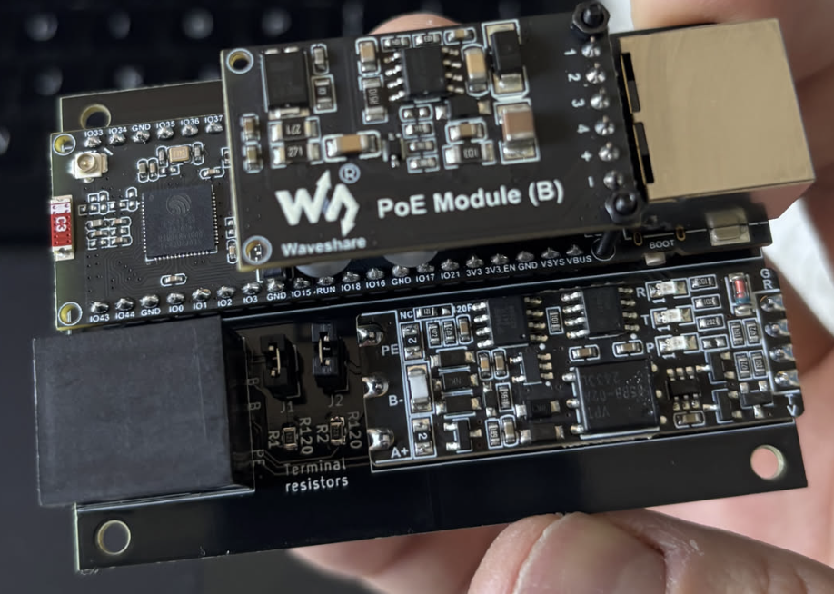

# Home automation · hardware & firmware

PCBs and ESPHome configurations for connecting existing appliances to Home Assistant.

Project records covering PCB design, firmware integration, and assembled hardware.

<table>
<tr>
<td width="45%">

</td>
<td valign="top">
<strong><a href="esp32-ap7921/">APC AP7921 controller retrofit</a></strong> 
An installed and working replacement controller bringing eight-outlet control and monitoring into Home Assistant. An internal board swap retains the enclosure, outlet hardware, and front-panel layout.  
Four-layer PCB · ESP32-C6 · CH390H Ethernet · ESPHome
</td>
</tr>
<tr>
<td>

</td>
<td valign="top">
<strong><a href="esp32-create-ceiling-fan-tuya/">Create ceiling-fan retrofit</a></strong> 
A replacement PCB with an ESP32-C3 module, support components, and programming connections, fitted to the original fan controller. ESPHome provides fan, light, and buzzer control over Tuya UART.  
PCB design · ESP32-C3 · Wi-Fi · Tuya UART
</td>
</tr>
<tr>
<td>

</td>
<td valign="top">
<strong><a href="esp32-climarad-v2x/">Climarad ventilation interface</a></strong> 
A carrier PCB connecting existing Ethernet/PoE and isolated RS485 modules, with a printed enclosure and Modbus integration for Home Assistant.  
Carrier PCB · ESP32-S3 · Ethernet / PoE · RS485 / Modbus
</td>
</tr>
</table>

## Design decisions

| Project | Requirement | Approach | Boundary |
|---|---|---|---|
| AP7921 retrofit | Replace the controller and integrate outlet control and monitoring into Home Assistant | Four-layer controller PCB and ESPHome firmware, fitted to the existing enclosure and front panel | AP7921 mounting points and front-panel openings; USB-C replaces the serial connector |
| Ceiling-fan retrofit | Expose the existing fan and light controls in Home Assistant | A custom ESP32-C3 board replaces the Wi-Fi interface and communicates with the retained controller over Tuya UART | Board fit and datapoint mappings are specific to the controller shown |
| Climarad interface | Connect ventilation controls and measurements to Home Assistant; power the interface through PoE | A custom carrier PCB combines Ethernet/PoE and isolated RS485 modules; ESPHome maps Modbus registers into entities | Uses the unit's Modbus interface and requires its device address |

All three projects use ESPHome's firmware framework and protocol components. The Climarad interface uses Waveshare modules for its ESP32, PoE, and isolated RS485 functions.

## Explore the projects

| Project | Hardware | Firmware | Additional material |
|---|---|---|---|
| [APC AP7921](esp32-ap7921/) | [Four-layer controller overview](esp32-ap7921/#four-layer-controller-pcb) | [ESPHome configuration and components](esp32-ap7921/firmware/) | [Installed retrofit](esp32-ap7921/#board-swap-retrofit) · [USB-C insert STL](esp32-ap7921/usb-c-insert.stl) |
| [Create ceiling fan](esp32-create-ceiling-fan-tuya/) | [KiCad design](esp32-create-ceiling-fan-tuya/kicad/) | [ESPHome configuration](esp32-create-ceiling-fan-tuya/esphome.yaml) | [Original and replacement hardware](esp32-create-ceiling-fan-tuya/#build-gallery) |
| [Climarad Sensa V2X](esp32-climarad-v2x/) | [KiCad design](esp32-climarad-v2x/kicad/) | [ESPHome configuration](esp32-climarad-v2x/esphome.yaml) | [Printable enclosure](esp32-climarad-v2x/case.3mf) |

These are hardware-specific project records. Read the compatibility and configuration notes before adapting a design to another appliance.

## License

- **Design files, documentation, and photographs:** [CC BY-NC 4.0](LICENSES/CC-BY-NC-4.0.txt).
- **Software and ESPHome configurations:** [PolyForm Noncommercial 1.0.0](LICENSES/PolyForm-Noncommercial-1.0.0.txt).

See [LICENSE](LICENSE) for scope.
