[← All projects](../README.md)

# APC AP7921 controller retrofit

**A four-layer replacement controller for the AP7921 rack PDU, bringing outlet control and monitoring into Home Assistant while retaining the original front-panel interface.**

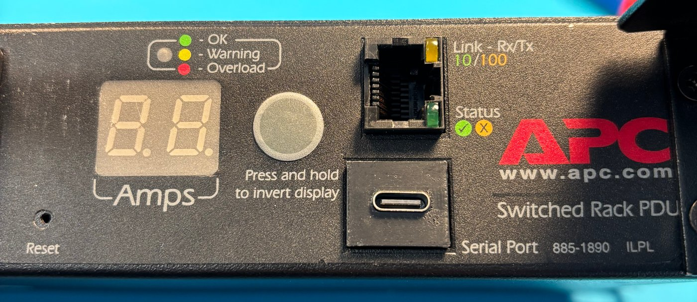

**Status: the board-swap retrofit is installed and working at home.**

## Board-swap retrofit

The retrofit replaces the internal control boards while retaining the PDU enclosure, outlet hardware, and internal connections. Installation requires a board swap, without case modifications or additional wiring.

The front-panel layout is retained: buttons, two-digit display, LED indicators, and Ethernet connector align with the original openings. **USB-C occupies the original serial-port position**; the original serial connector and protocol are not retained. A [3D-printed insert (STL)](usb-c-insert.stl) fills the gap around the smaller USB-C connector in the original modular serial-port opening.

Mechanical fit and firmware behaviour are developed together: the board must meet the existing mounting points and connector positions, while the replacement firmware drives the local controls and indicators.

The photograph above shows front-panel fit, with the display unpowered.

## Original controller

The original controller uses two stacked boards. These views show the front-panel hardware, processor board, and internal connections that the replacement has to fit.

<table>
<tr>
<td width="50%">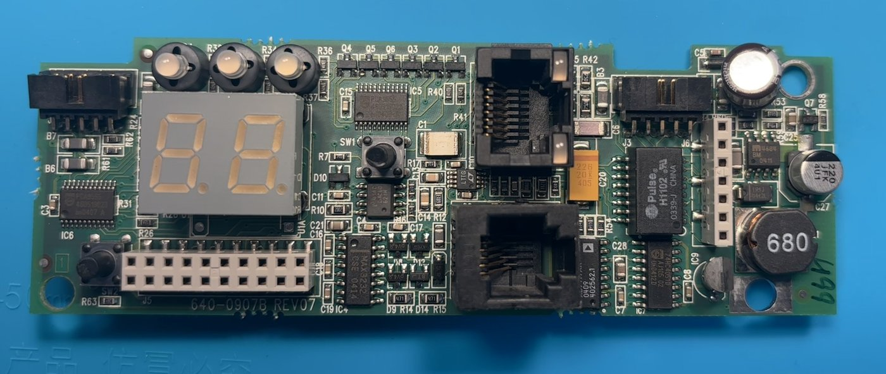</td>
<td width="50%">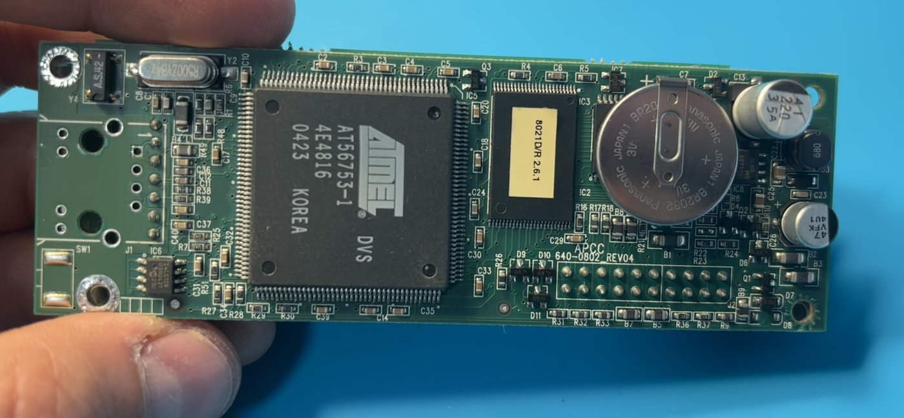</td>
</tr>
<tr>
<td>Original front-panel board.</td>
<td>Processor-board side of the original assembly.</td>
</tr>
<tr>
<td>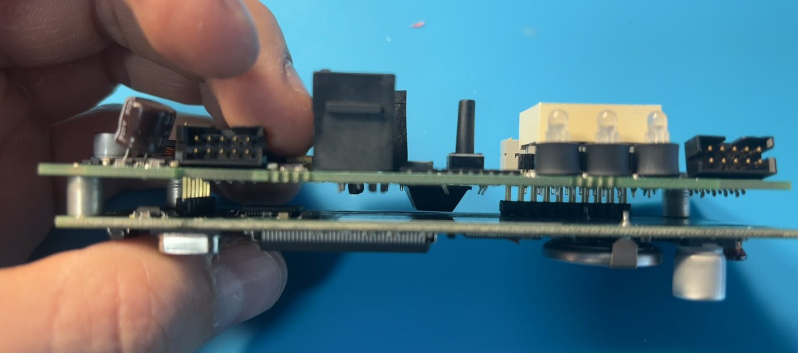</td>
<td>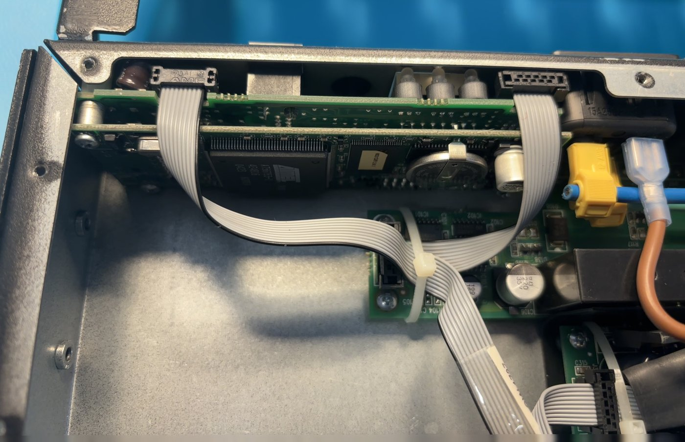</td>
</tr>
<tr>
<td>Two-board stack and spacers.</td>
<td>Original controller installed in the enclosure.</td>
</tr>
</table>

## Four-layer controller PCB

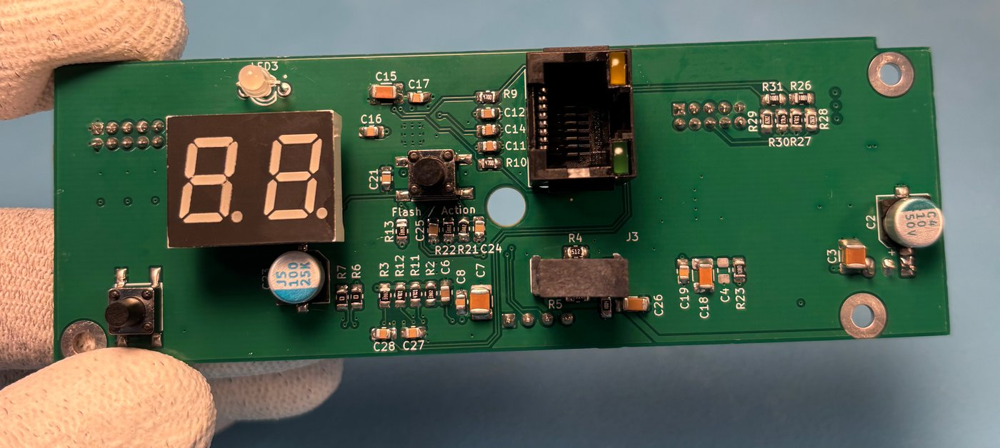

*Assembled controller: display, buttons, indicators, Ethernet, and USB-C share the replacement board.*

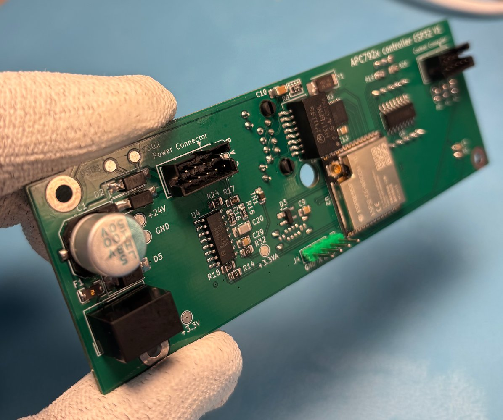

*Back of the assembled controller, including the controller and connections to the retained PDU hardware.*

The controller uses a **four-layer PCB**, an ESP32-C6, and CH390H Ethernet. The design brings network connectivity, current measurement, supply monitoring, outlet control, and the local user interface together on the replacement controller.

### PCB layout

The layout follows the existing board outline, mounting holes, and front-panel connector positions. These screenshots show the V1.1 design; the photographs of the installed, working device show V1.

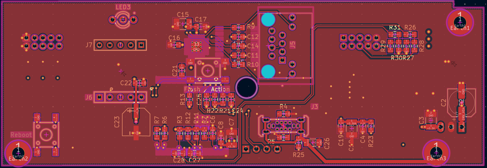

*Front-side layout view.*

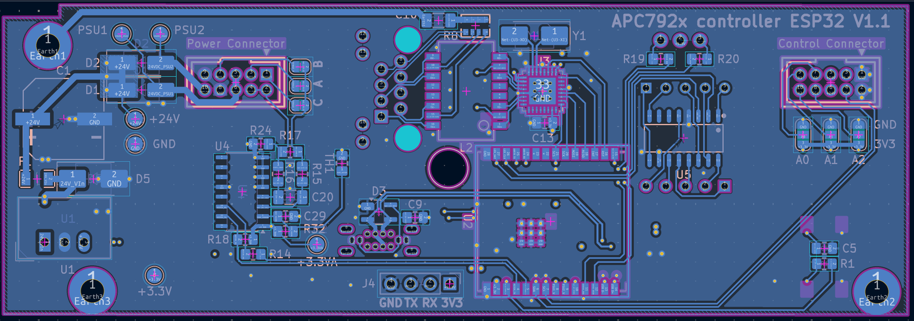

*Back-side layout view.*

Inner copper layers

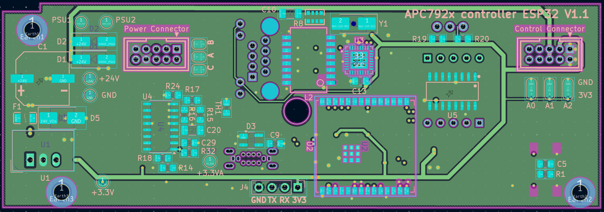

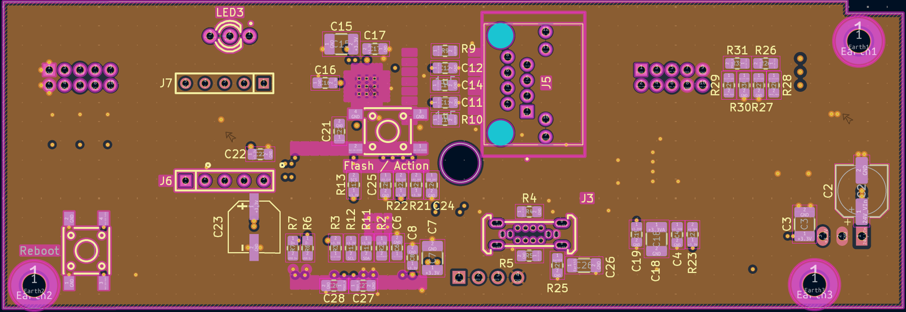

*The remaining inner layer is a solid GND fill.*

### System integration

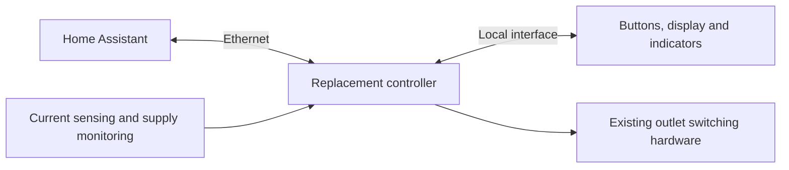

The firmware builds on ESPHome, with local component changes for the hardware and its operating requirements. One specific requirement is preserving outlet states through a controller restart: rebooting the management interface should not interrupt attached equipment.

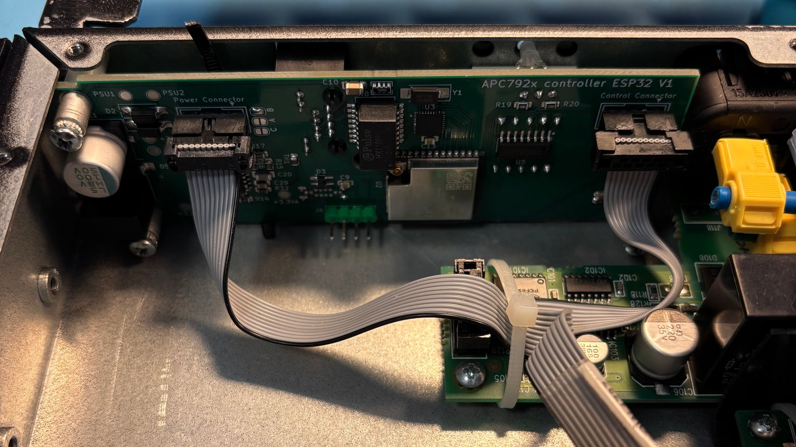

*Controller installed using the existing mounting points and ribbon connections.*

## Firmware implementation

[The firmware source](firmware/) includes the complete ESPHome configuration and local components. [Build instructions](firmware/README.md#build) describe setup with example credentials.

The ESPHome configuration implements:

| Area | Implementation |
|---|---|
| Outlet control | Eight outlet switches exposed to Home Assistant |
| Power-up behaviour | Per-outlet start delay and selectable off/on/previous state after power loss |
| Controller restart | Logic to preserve outlet states across controller restarts |
| Monitoring | Total load current, metering-chip temperature, and both internal supply voltages |
| Load management | Configurable low-load, near-overload, and overload indications; per-outlet turn-on restrictions |
| Display | Local current readout, brightness adjustment, and orientation setting |
| Buttons | Long-press IP-address display and display-orientation control |
| Status indicators | Network, startup, and hardware-fault indication |

The physical user interface is retained, with updated firmware behaviour for recovery and some button/indicator states. Load thresholds provide software indications and switching restrictions, not certified overcurrent protection.

## Planned ESPHome contributions

Reusable changes are intended for upstream submission, beginning with **CH390H Ethernet support**. Other candidates include preserving output states during component initialization and extensions to the current-meter component.

These contributions are planned, not yet submitted.

## Compatibility

The retrofit is installed and working in an **AP7921**. Other APC models and hardware revisions have not been established as compatible.
