[← All projects](../README.md)

# Climarad ventilation interface

**A PoE-powered ESPHome interface for bringing a Climarad Sensa V2X ventilation unit into Home Assistant over Modbus.**

*The assembled carrier board, with the Ethernet/PoE and RS485 modules fitted.*

## Design

The interface connects a [Climarad Sensa V2X ventilation unit](https://www.climarad.nl/en/products/climarad-sensa-v2x/) to Home Assistant, using PoE for power.

A carrier PCB brings together a Waveshare [ESP32-S3 Ethernet board with PoE](https://www.waveshare.com/esp32-s3-eth.htm?sku=28771) and an [isolated TTL-to-RS485 module](https://www.waveshare.com/ttl-to-rs485-c.htm). The ESPHome configuration maps the ventilation unit's Modbus registers into sensors and controls. A printable enclosure is included with the design.

Modbus communication uses ESPHome's [Modbus Controller component](https://esphome.io/components/modbus_controller/).

## Carrier PCB

The board provides module mounting and interconnection between the ESP32-S3 board, isolated RS485 module, and Modbus connector. The Ethernet/PoE and RS485 circuitry resides on the modules; the carrier layout focuses on their placement and connections.

<a href="images/pcb-design-front.png">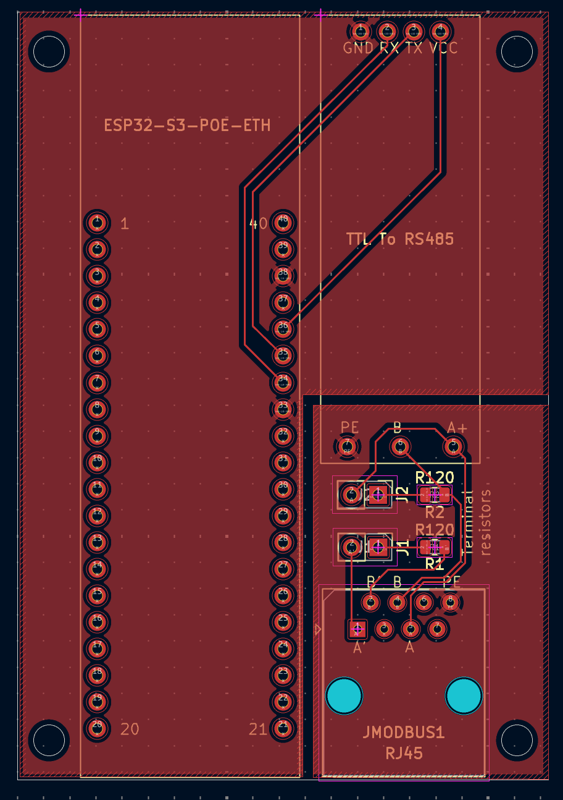</a>
<a href="images/pcb-design-back.png">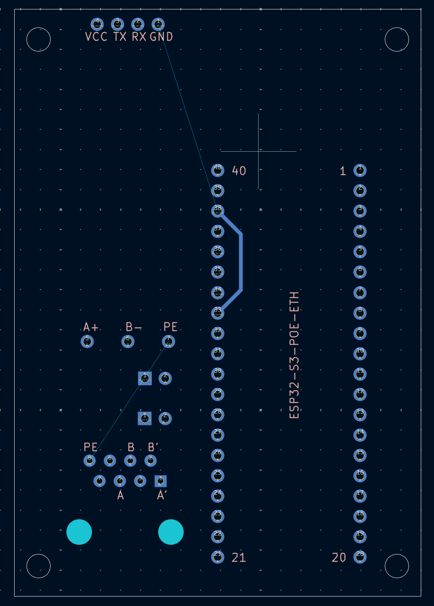</a>

*Front and back carrier-board layouts. Select either image for full resolution.*

[PCB source](kicad/climarad.kicad_pcb) · [Schematic source](kicad/climarad.kicad_sch) · [KiCad project](kicad/climarad.kicad_pro)

View the schematic

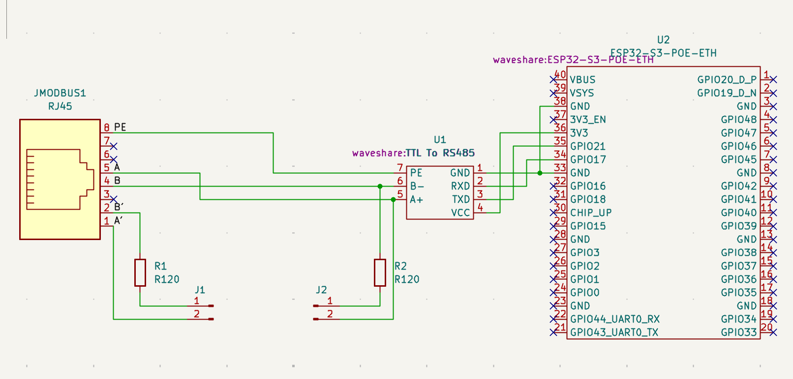

### Enclosure

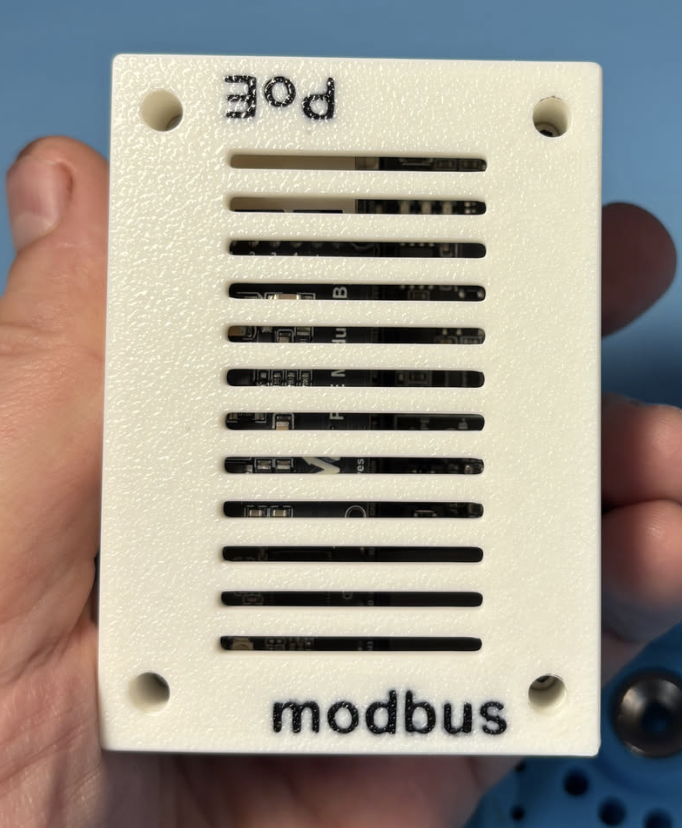

[Printable enclosure](case.3mf)

## System overview

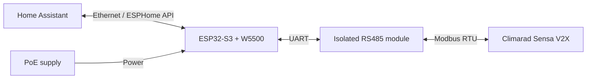

The custom PCB carries the ESP32 and RS485 modules. Choosing a PoE-capable module addressed the power requirement while keeping the board focused on interconnection. The published configuration uses Ethernet for Home Assistant communication and a separate UART for Modbus.

## Published firmware capabilities

The [ESPHome configuration](esphome.yaml) defines:

| Area | Entities |
|---|---|
| Air measurements | CO₂, humidity, temperature |
| Diagnostics | Supply/exhaust fan speed, current mode, decoded error flags, desired CO₂, filter-reset count |
| Controls | Operating mode, desired CO₂ level, child lock, window-ventilation setting |
| Adjustment | CO₂ compensation, LED brightness |

Measurement conversion and filtering are explicit in the YAML: humidity and temperature registers are scaled, and CO₂ values `0` and `32767` are filtered out. These details can be inspected alongside the register addresses and mode mappings.

## Sources and configuration

| File | Contents |
|---|---|
| [esphome.yaml](esphome.yaml) | Ethernet, Modbus register mappings, sensors, and controls |
| [kicad/](kicad/) | Schematic, PCB layout, and KiCad project |
| [case.3mf](case.3mf) | Printable enclosure |

This project targets a Sensa V2X with its Modbus interface. In `esphome.yaml`, replace the placeholder Modbus address `000` with the address for your unit; the configuration notes identify the Modbus module cable as the place to find it. Review device naming, API encryption, and OTA authentication for your installation.

The photographs document the assembled board and enclosure. The repository does not include runtime measurement logs or a compatibility test matrix for other Climarad models.

## Build gallery

More assembly and enclosure photographs

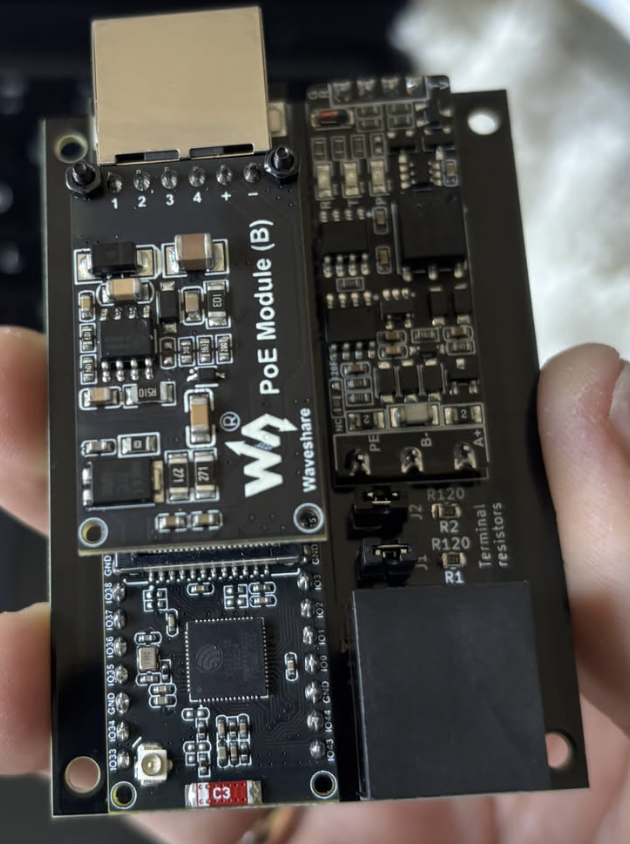

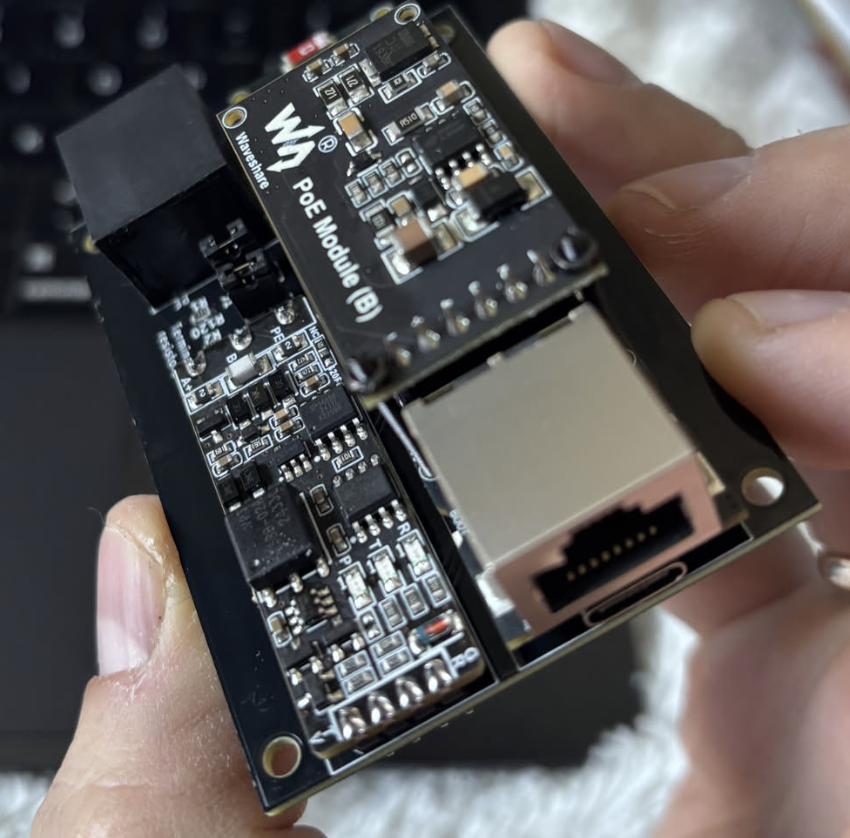
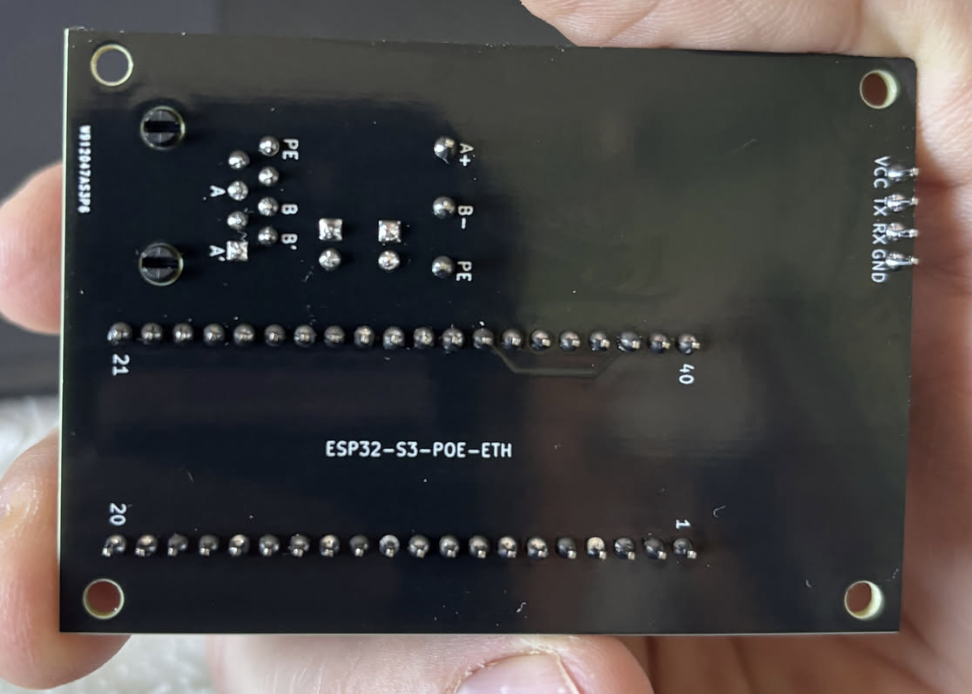
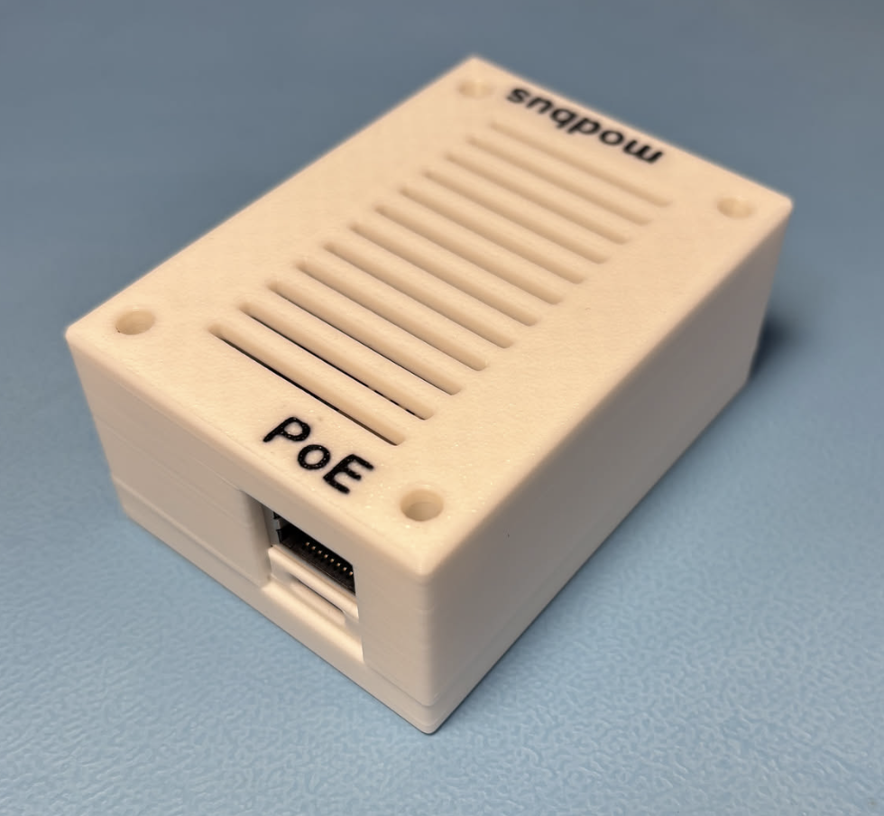
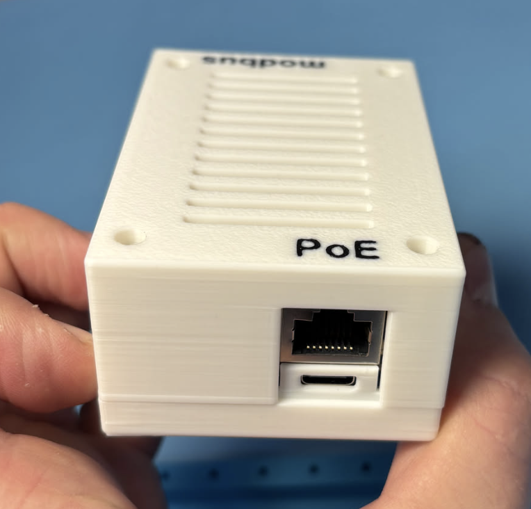
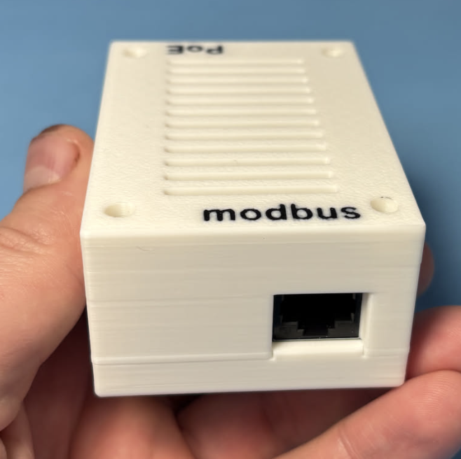

