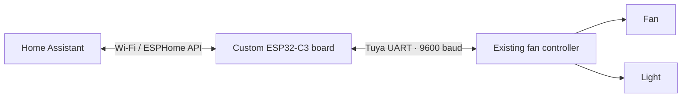

[← All projects](../README.md)

# Create ceiling-fan retrofit

**A custom ESP32-C3 interface board and ESPHome configuration for fan and light control in Home Assistant.**

*The assembled replacement board, front and back.*

## Design

The PCB replaces the WBR3 Wi-Fi module and associated daughterboard arrangement in the [Create ceiling fan](https://www.create-store.com/uk/2401-buy-ceiling-fans) shown below. The replacement uses an ESP32-C3 running ESPHome and communicates with the existing appliance controller through the Tuya UART protocol.

The fan's existing controller remains responsible for appliance control; ESPHome provides the [Tuya MCU protocol component](https://esphome.io/components/tuya/).

## PCB design

The replacement board combines the ESP32-C3 module, support components, flash/reset buttons, and programming connections in the footprint shown below. Components and routing occupy both sides of the board; the module's antenna area is marked at the top of the layout.

*Front and back layout views. Select either image for full resolution.*

[PCB source](kicad/create-celing-fan.kicad_pcb) · [Schematic source](kicad/create-celing-fan.kicad_sch) · [KiCad project](kicad/create-celing-fan.kicad_pro) · [BOM](#bill-of-materials)

View the schematic

### Fit in the original controller

*The replacement interface board fitted to the existing controller assembly. The board outline and connection positions need to suit this hardware; the original motor and light controller remains in place.*

## Bill of materials

- [Assembly BOM (CSV)](bom.csv) — manufacturers, part numbers, quantities, and footprints.
- [KiCad BOM export (CSV)](kicad/create-celing-fan.csv) — references, quantities, values, and footprints matching the published PCB.

The assembled board used capacitors, resistors, and buttons from assortment kits. The assembly BOM reconstructs suitable part selections rather than an exact record of every fitted part; confirm substitutions and footprints before ordering assembly.

## System overview

The published configuration disables UART logging to leave that serial interface available for communication with the fan controller. Fan and light entities use `ALWAYS_OFF` as their configured restore mode.

## Flashing and first boot

The programming connection and Tuya communication share **GPIO20 (ESP RX) and GPIO21 (ESP TX)**. During flashing they connect to the USB–UART adapter; in normal operation they communicate with the fan controller.

Flash the replacement board separately from the mains-powered controller, using a suitable 3.3 V supply and 3.3 V UART logic.

| USB–UART adapter | Replacement board |
|---|---|
| TX | RX / GPIO20 |
| RX | TX / GPIO21 |
| GND | GND |

1. Fit the **Flash jumper**, then press and release **Reset** to enter download mode.
2. Flash the firmware.
3. Remove the Flash jumper and disconnect the adapter's TX/RX leads before normal operation. Reset to boot the firmware.
4. With power disconnected, install the replacement board in the matching controller. Verify operation through Wi-Fi/Home Assistant.

The header's **EN-labelled contact is not connected to the ESP reset circuit in this design**; do not use it as an RTS auto-reset connection. Use the board's Reset control. See the [project flashing discussion](https://github.com/ikruglov/home-automation/issues/2#issuecomment-4596481200) and [Espressif's download-mode documentation](https://docs.espressif.com/projects/esptool/en/latest/esp32c3/advanced-topics/boot-mode-selection.html).

### Repeated resets after a successful flash

In [issue #2](https://github.com/ikruglov/home-automation/issues/2), a builder flashed successfully but then saw repeated resets while connected through a laptop dock. The board came online after moving the adapter to a power-only USB source; it also came online when fitted to the powered controller. The fan itself had not yet been connected in that report.

Shared-UART interference was the suspected explanation: after boot, those pins carry Tuya traffic rather than a programming session. However, power and USB data conditions changed together, so the report does not isolate the reset cause. Disconnect the programmer's TX/RX for normal operation and check the power supply if resets continue. Keep `logger.baud_rate: 0`, as configured, to avoid injecting log messages into the Tuya UART. [ESPHome logger documentation](https://esphome.io/components/logger/#configuration-variables)

## Published firmware capabilities

The [ESPHome configuration](esphome.yaml) maps the following Tuya datapoints:

| Function | Datapoint(s) | Configuration |
|---|---|---|
| Fan | 60, 62, 63 | On/off, six speed levels, direction |
| Light | 20, 22 | On/off and brightness |

It also exposes connection status, Wi-Fi signal, uptime, and a restart button. Color-temperature settings are commented out in the published YAML and are not presented here as an implemented feature.

## Compatibility and sources

**Match the controller hardware, not just the fan's product name.** This project was developed for a fan that already had Wi-Fi. The original project notes identify different controller modules sold under the same Create model name; compare your hardware with the original-board photographs below.

| File | Contents |
|---|---|
| [esphome.yaml](esphome.yaml) | ESP32-C3 configuration and Tuya datapoint mappings |
| [kicad/](kicad/) | Schematic, PCB layout, KiCad project, and component CSV |

Before adapting the configuration, replace the `XXX` Wi-Fi placeholders and review device naming, API encryption, and OTA authentication. GPIO assignments and datapoint mappings describe the hardware shown here.

The photographs document assembly and fitment to the original controller. They do not establish compatibility with other controller revisions.

## Build gallery

Additional installation photograph

### Original hardware

Original board and installation — compare these before adapting the design

The original photographed assembly does not have a separate 5 V ↔ 3.3 V logic daughterboard.

