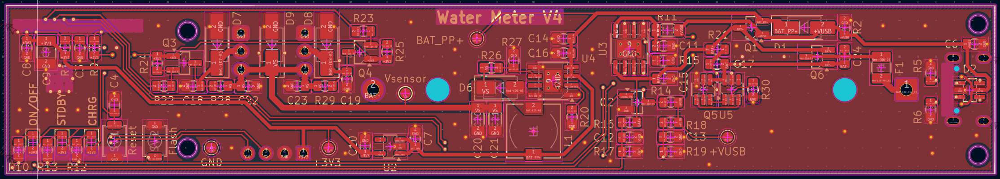
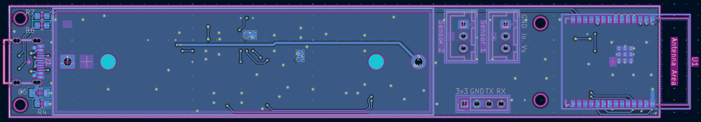
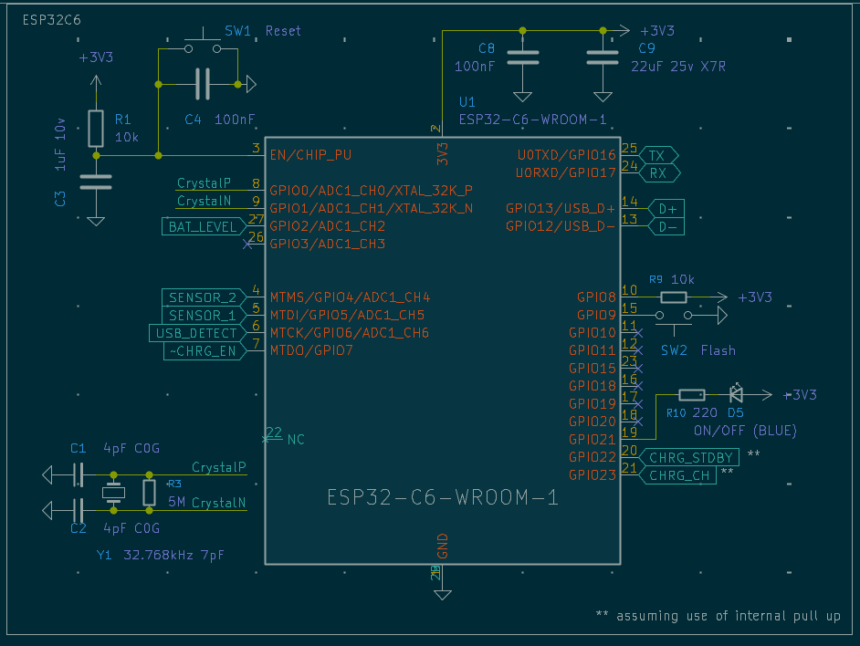
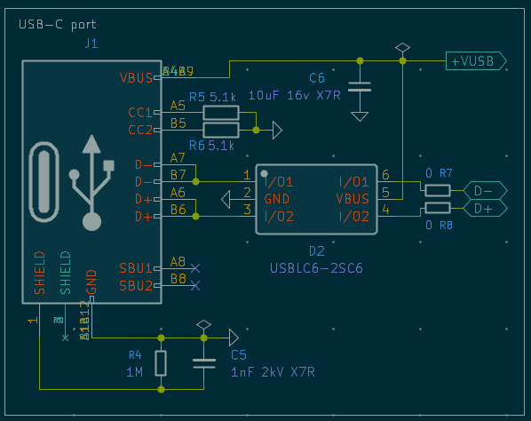
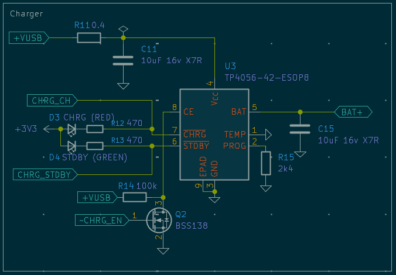
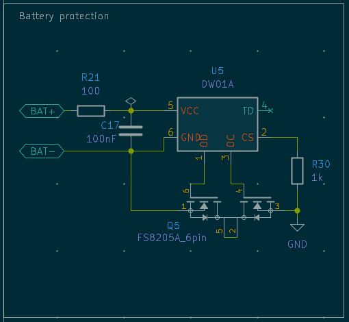
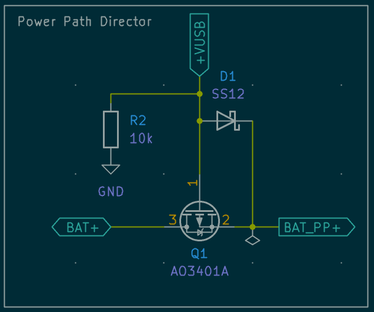
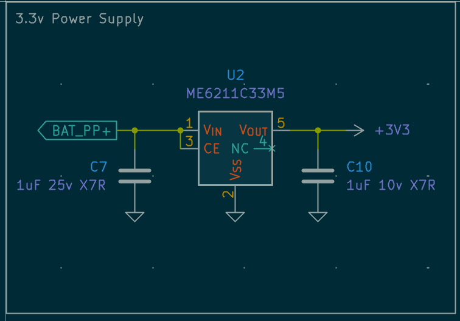
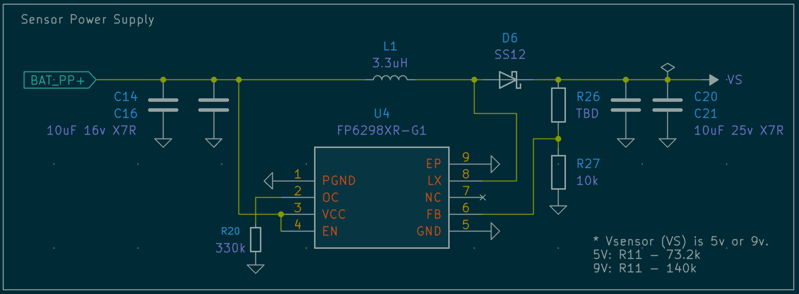

[← All projects](../README.md)

# ESP32 water-meter reader

**Assembled and tested; improvements in progress.** A custom ESP32-C6 board for reading a mechanical water meter with an inductive proximity sensor and reporting cumulative consumption to Home Assistant over Wi-Fi.

The 18650 cell acts as a **local UPS**: its purpose is to keep the controller and sensor powered when USB power is disconnected, so counting can continue. The board also provides two sensor inputs to support rejecting false counts from small movements at the rotating target’s detection boundary. The hardware has been assembled and tested; the current firmware uses Wi-Fi and one sensor, with further improvements in progress.

## Design decisions

| Requirement | Approach | Current state |
|---|---|---|
| Keep counting when external power is disconnected | Rechargeable 18650 backup, USB/battery power path, and a separate sensor supply | Board assembled and tested; backup runtime and changeover measurements are not yet documented |
| Avoid counting repeated movements at a detection boundary | Two sensor inputs, intended to distinguish progression of the rotating target from repeated crossings at one sensor | Current firmware counts one debounced input; two-sensor sequence logic remains to be implemented |
| Keep a future Zigbee option | ESP32-C6, whose radio supports IEEE 802.15.4 as well as Wi-Fi | Current firmware uses ESPHome over Wi-Fi; Zigbee is a future option |

If the target stops at one sensor's switching boundary, tiny movements can generate repeated detections without a complete rotation. The intended two-sensor approach checks the sequence of detections to reject that back-and-forth motion. It requires suitable sensor placement and sequence logic; adding a second input alone does not solve it.

The ESP32-C6 radio capability is documented in the [Espressif datasheet](https://documentation.espressif.com/esp32-c6_datasheet_en.html). Zigbee support would require a corresponding firmware implementation.

## Hardware

[KiCad project and libraries](hardware/)

The board brings together:

- ESP32-C6 control, Wi-Fi connectivity today, and hardware support for a future Zigbee implementation.
- An inductive proximity-sensor interface, with two inputs routed and one used by the current firmware.
- USB-C input and charging, an 18650 backup cell, and USB/battery power-path circuitry.
- A sensor supply configurable in the design for 5 V or 9 V; the firmware's development notes describe a 9 V sensor setup.
- Battery-voltage measurement, USB-presence detection, charger status, and UART debug connections.

The electrical design and PCB layout are included. The hardware notes still leave **F1 selection** open. See the [hardware notes](hardware/README.md) for library dependencies and the boundary between design files and validation.

### Battery and interface protection

The design includes several distinct protection circuits:

- **Reverse battery polarity:** a P-channel MOSFET (Q6) in the battery connection.
- **Cell overcharge, overdischarge, and overcurrent/short-circuit protection:** the battery protection controller (U5) drives the dual MOSFET (Q5) to disconnect the cell when its protection conditions are reached.
- **Additional battery-path overcurrent protection:** a resettable fuse (F1); its selection is still flagged for review in the design notes.
- **Interface transients:** USB ESD protection and TVS devices on the sensor-side connections/supply.

These describe the circuit's intended functions, not completed fault-injection testing. The [hardware notes](hardware/README.md#protection-circuit-references) identify the component references and supporting datasheets.

### PCB layout and schematics

*Front-side layout of the V4 board.*

*Back-side layout, including the battery-holder area and ESP32 antenna area.*

Controller, USB, and power-circuit schematics

#### ESP32-C6 controller

#### USB-C input

#### Charger

#### Battery protection

#### Power path

#### 3.3 V supply

#### Sensor supply

## Enclosure

[3D-printable case models](case/) are included as separate STL files for the
[case body](case/case.stl), [cover](case/cover.stl), and [text](case/text.stl).

## Firmware

[ESPHome configuration and build instructions](firmware/)

| Feature | Current implementation |
|---|---|
| Counting | Debounced detections on one sensor input; default scaling is 1 litre per pulse |
| Meter reading | Adjustable initial reading plus counted consumption, reported in m³ |
| Persistence | Restored pulse counter with a delayed preference flush after a burst starts |
| Diagnostics | Battery voltage, USB connection, charger state, Wi-Fi signal, and uptime |
| Controls | Charger enable, power LED, and counter reset |
| USB handling | A local helper controls the USB D+ pull-up according to detected USB power |

The pulse scaling and debounce interval must match the actual meter and sensor placement. The current configuration keeps Wi-Fi connected. The battery is backup for counting continuity, rather than a claim of long-term battery-only operation. Single-input debounce is implemented; the planned two-sensor sequence check is not.

## Development status

The board has been assembled and tested. Further improvements include two-sensor counting logic; Zigbee remains a possible future direction. The public firmware configuration passes ESPHome 2026.7.4 configuration validation and C++ source generation with dummy credentials; this export has not yet been compiled or reflashed.

The design notes still list F1 selection as open; those notes need reconciling with the assembled board. Pulse accuracy, power-loss counter retention, USB/battery transitions, and battery runtime are useful areas to document as the project develops.
